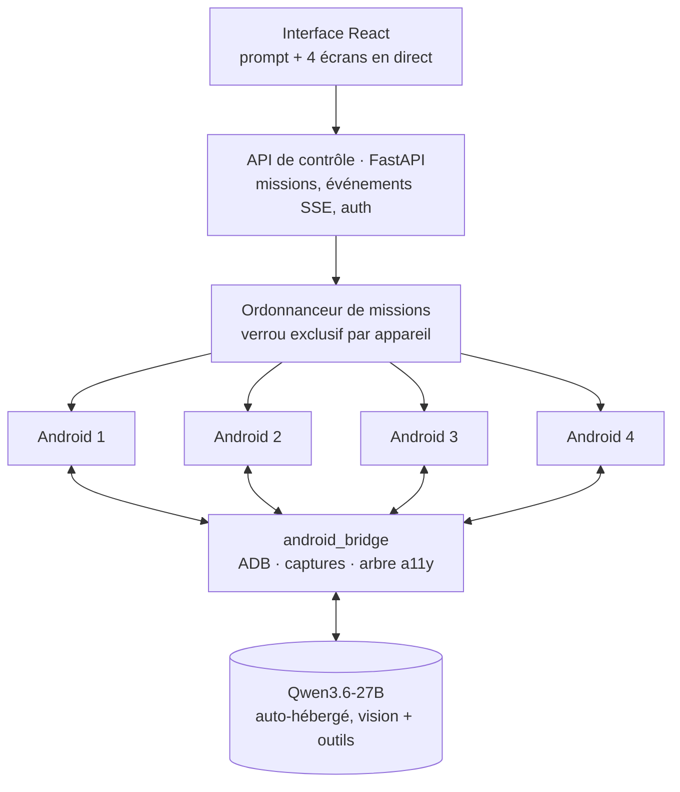

# Android LLM Agent — un prompt, quatre Android

**Plateforme web pour exécuter des missions sur quatre émulateurs Android à partir d'un seul prompt, avec un LLM de vision auto-hébergé (Qwen3.6-27B) qui lit l'écran, agit et vérifie.** Mur d'écrans 2×2 en direct, prise en main manuelle exclusive, bibliothèque d'APK et journal d'événements rejouable.

[](https://github.com/Matt95354855/android-llm-agent/actions/workflows/ci.yml)    

[English](README.md) · [Français](README.fr.md)

## Ce qui existe aujourd'hui

| Composant | Emplacement | État |
|---|---|---|
| Adaptateur Android — ADB, capture + arbre d'accessibilité, actions typées, saisie Unicode, exclusion caméra/micro/GPS, cycle de vie des émulateurs | `services/android/android_bridge` | Implémenté ; tests sur vrai appareil dans le job CI `emulator` |
| Service de contrôle (FastAPI) — appareils, contrôle manuel exclusif, missions, événements SSE rejouables, APK, authentification | `services/control/control` | Fonctionne en démo, 19 tests |
| Interface web — mur 2×2, prise en main, prompt, missions, APK, journal | `apps/web` | Fonctionne en démo |
| Image Pod, templates RunPod, diagnostic, contrôle préalable, outil RunPod plafonné | `infra/`, `scripts/` | Écrits, pas encore exécutés sur RunPod |
| Boucle agent (observer → décider → agir → vérifier) et orchestration des missions | — | **Prochaine étape** |

## Architecture



Boucle agent : **observer** (capture + arbre d'accessibilité) → **décider** (Qwen) → **agir** (action ADB typée) → **vérifier**.

## Démarrage rapide (mode démo, appareils factices)

```bash
git clone https://github.com/Matt95354855/android-llm-agent.git
cd android-llm-agent
uv sync && (cd apps/web && npm ci && npm run build)
PE_ALLOW_NO_AUTH=1 PE_DEVICE_BACKEND=demo uv run phone-emulator   # http://localhost:8000
uv run pytest
```

## Structure du dépôt

```text
apps/web/            interface React + Vite (sombre, en français)
services/control/    plan de contrôle FastAPI : appareils, missions, événements, APK, auth
services/android/    passerelle ADB et cycle de vie des émulateurs
infra/               images de conteneur et templates RunPod
scripts/             amorçage du pod, SDK Android, contrôle préalable, CLI RunPod
tests/               tests unitaires + tests d'intégration marqués emulator
docs/                architecture, feuille de route (420 tâches, 26 chantiers), notes RunPod
```

## Démarche d'ingénierie

Le projet est planifié avant d'être annoncé : un [cahier des charges](docs/roadmap/CAHIER_DES_CHARGES.md) de **420 tâches, 26 chantiers, dépendances, critères de sortie et 22 scénarios de recette**. Deux prérequis bloquants sont suivis explicitement — quatre Android accélérés sur RunPod et quatre IP publiques de sortie fixes — et rien n'est déclaré fonctionnel avant d'être mesuré. GPS, caméra et micro sont exclus par conception ; APK, poids de modèle, comptes et captures privées restent hors du dépôt.

## Documentation

[Guide détaillé](docs/GUIDE.fr.md) · [Architecture](docs/architecture) · [Feuille de route](docs/roadmap) · [RunPod](docs/runpod)
