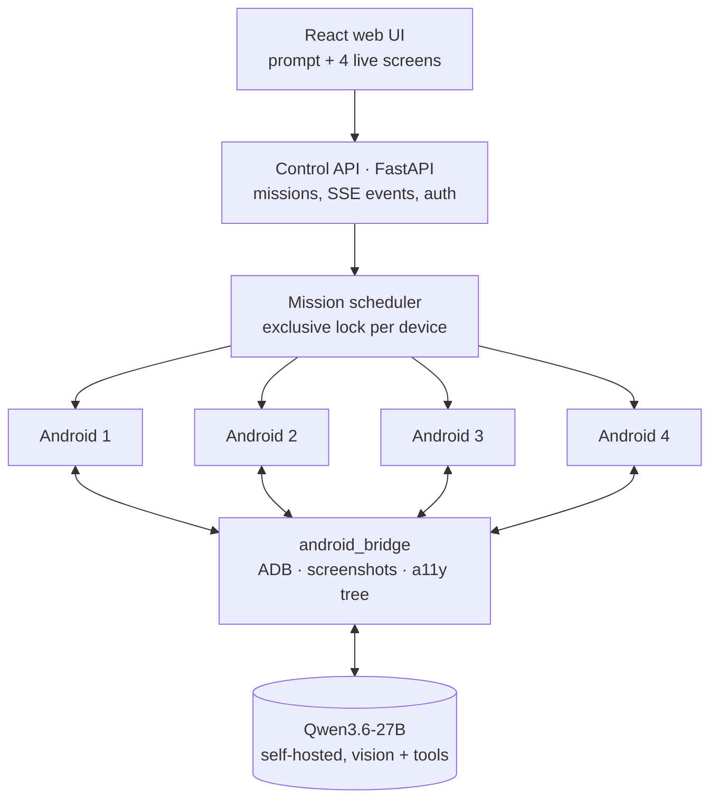

# phone_emulator — LLM agent driving four Android devices

**A web platform to run missions on four Android emulators from a single prompt, with a self-hosted vision LLM (Qwen3.6-27B) that reads the screen, acts and verifies.** Live 2×2 screen wall, exclusive manual takeover, APK library and replayable event log.

[](https://github.com/Matt95354855/phone_emulator/actions/workflows/ci.yml)    

[English](README.md) · [Français](README.fr.md)

## What exists today

| Component | Location | Status |
|---|---|---|
| Android adapter — ADB, screen capture + accessibility tree, typed actions, Unicode input, camera/mic/GPS exclusion, emulator lifecycle | `services/android/android_bridge` | Implemented; real-device tests in the CI `emulator` job |
| Control service (FastAPI) — devices, exclusive manual control, missions, replayable SSE events, APK library, auth | `services/control/control` | Runs in demo mode, 19 tests |
| Web UI — 2×2 live wall, takeover, prompt, missions, APKs, log | `apps/web` | Runs in demo mode |
| Pod image, RunPod templates, diagnostics, preflight, spend-capped RunPod tool | `infra/`, `scripts/` | Written, not yet run on RunPod |
| Agent loop (observe → decide → act → verify) and mission orchestration | — | **Next milestone** |

## Architecture



Agent loop: **observe** (screenshot + accessibility tree) → **decide** (Qwen) → **act** (typed ADB action) → **verify**.

## Quick start (demo mode, fake devices)

```bash
git clone https://github.com/Matt95354855/phone_emulator.git
cd phone_emulator
uv sync && (cd apps/web && npm ci && npm run build)
PE_ALLOW_NO_AUTH=1 PE_DEVICE_BACKEND=demo uv run phone-emulator   # http://localhost:8000
uv run pytest
```

## Repository structure

```text
apps/web/            React + Vite UI (dark, French)
services/control/    FastAPI control plane: devices, missions, events, APKs, auth
services/android/    ADB bridge and emulator lifecycle
infra/               container images and RunPod templates
scripts/             pod bootstrap, Android SDK install, preflight, RunPod CLI
tests/               unit tests + emulator-marked integration tests
docs/                architecture, roadmap (420 tasks, 26 workstreams), RunPod notes
```

## Engineering approach

The project is planned before it is claimed: a [specification](docs/roadmap/CAHIER_DES_CHARGES.md) with **420 tasks, 26 workstreams, dependencies, exit criteria and 22 acceptance scenarios**. Two hard prerequisites are tracked explicitly — running four accelerated Androids on RunPod and four fixed public egress IPs — and nothing is reported as working until it is measured. GPS, camera and microphone are excluded by design; APKs, model weights, accounts and private captures stay out of the repository.

## Documentation

[Detailed guide (FR)](docs/GUIDE.fr.md) · [Architecture](docs/architecture) · [Roadmap](docs/roadmap) · [RunPod](docs/runpod)
