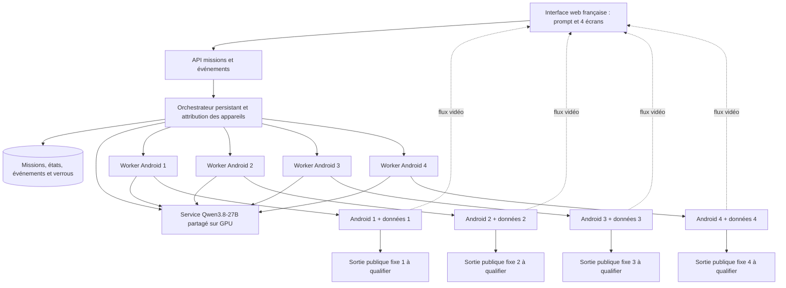

# phone_emulator — cahier des charges et to-do list

Version de travail du **19 octobre 2026**, fondée sur la demande et les précisions du propriétaire. Dépôt cible : [Matt95354855/phone_emulator](https://github.com/Matt95354855/phone_emulator), **public**. Sa racine ne contenait qu’un README de 16 octets lors de la consultation : aucun émulateur, agent ou déploiement n’y est actuellement démontré.

Ce document décrit le produit à construire. Les fonctionnalités des projets comparés sont documentées par leurs auteurs ; elles n’ont pas été exécutées dans le cadre de cette recherche. Les critères et les dimensionnements proposés ici sont des objectifs de conception, pas des performances déjà obtenues.

## 1. Besoin confirmé

| Sujet | Décision retenue |
|---|---|
| Appareils | Quatre vrais environnements Android distincts, visibles et contrôlables en direct. |
| Applications | Les applications du propriétaire, distribuées sous forme d’APK téléchargés depuis Internet. |
| Agent | Qwen3.8-27B auto-hébergé ; variante communautaire uncensored à qualifier. Il doit lire les écrans, comprendre la mission et exécuter les actions. |
| Autonomie | Contrôle étendu des applications, paramètres et fichiers Android ; pas de script figé comme unique mode de fonctionnement. |
| Exclusions explicites | Pas de GPS, de caméra ou de microphone. Pas de géolocalisation simulée proposée à l’agent. |
| Missions | Missions indépendantes en parallèle et mission commune répartie entre les quatre téléphones. |
| Hébergement | **Tout sur Runpod**. Aucun serveur d’émulation externe proposé comme architecture conforme. Plusieurs Pods restent une possibilité technique à confirmer. |
| Réseau | **Quatre IP publiques de sortie distinctes et fixes, conservées après arrêt et redémarrage.** |
| Interface | Interface web en français, thème sombre par défaut, champ de mission et mur de quatre écrans. |
| GitHub | Code et documentation dans le dépôt public `phone_emulator`. Données d’exploitation et secrets conservés séparément. |
| Distribution | Images de conteneur versionnées et template Runpod pour redéploiement rapide. |
| Exploitation | Le propriétaire démarre et arrête lui-même. Aucun budget chiffré communiqué ; cela ne constitue pas un choix de ressources illimitées. |
| iOS | Hors périmètre : Android uniquement. |

« Local » signifie ici que l’inférence est exécutée sur les ressources Runpod du projet, sans fournisseur d’inférence distant obligatoire. L’agent peut naviguer et utiliser Internet depuis les téléphones.

« Accès étendu » doit devenir une liste de capacités réelles : installer un APK, lire un écran, toucher, saisir, ouvrir une application, gérer fichiers et paramètres, utiliser ADB et éventuellement root dans Android. Le verrou d’un appareil, l’arrêt utilisateur et l’isolation des quatre environnements sont des mécanismes de fonctionnement. Les seules exclusions fonctionnelles déjà imposées sont GPS, caméra et microphone.

## 2. Les deux validations qui conditionnent tout

### 2.1 Quatre Android utilisables sur Runpod

Les Pods sont des conteneurs. La documentation Runpod indique que Docker Compose et le lancement de son propre Docker à l’intérieur d’un Pod ne sont pas pris en charge. Elle ne fournit pas, dans les pages consultées, de garantie d’accès à KVM. Il faut donc qualifier le matériel et le Pod réels avant de retenir une architecture d’émulation. Le projet utilisera une image directement exécutée par Runpod, sans Docker imbriqué. [Runpod : Pods](https://docs.runpod.io/pods/overview)

Sous Linux, Android Emulator utilise KVM pour l’accélération des machines virtuelles. Le premier livrable doit être une preuve : démarrage d’un Android dans le Pod candidat, APK installé, capture visible et gestes exécutés, puis passage à quatre appareils. [Android : accélération](https://developer.android.com/studio/run/emulator-acceleration)

**Décision de passage :** si aucun profil Runpod accessible ne satisfait les prérequis et les performances, la contrainte « tout sur Runpod » reste non satisfaite. Une interface factice, une vidéo préenregistrée ou un émulateur inutilisable ne valent pas validation. Un mode logiciel sans KVM peut être mesuré, mais ne devient acceptable que s’il satisfait les mêmes critères d’usage.

### 2.2 Quatre IP de sortie réellement fixes

Une MAC distingue une interface sur un segment réseau ; elle ne crée pas une IP publique. Des interfaces virtuelles et quatre IP privées derrière un NAT peuvent toutes sortir avec la même IP publique. Les IP à contrôler sont celles observées par les services Internet depuis chaque Android. [Docker : réseau](https://docs.docker.com/engine/network/)

Runpod documente des IP et mappings pour l’accès entrant aux Pods ; cela ne prouve ni quatre sorties Internet distinctes ni leur réservation après arrêt. Sa documentation précise que certains mappings changent au reset. Il faut obtenir une réponse explicite sur l’allocation, la sortie réelle et la conservation des adresses, puis les mesurer. [Runpod : ports](https://docs.runpod.io/pods/configuration/expose-ports)

**Décision de passage :** si Runpod ne peut pas fournir cette propriété dans le périmètre retenu, la version conforme aux quatre IP fixes ne peut pas être déclarée livrée. La carte réseau du Mac personnel n’intervient pas dans le trafic de téléphones hébergés sur Runpod. Macvlan ne constitue pas une solution de référence : les clouds le bloquent souvent et Docker Desktop sur Mac ne le prend pas en charge. [Docker : macvlan](https://docs.docker.com/engine/network/drivers/macvlan/)

## 3. Ce qui existe déjà et ce qu’on reprend

Le but est de réutiliser des composants et des méthodes éprouvés, avec leurs licences, puis de construire les éléments manquants. Les produits hébergés commerciaux ne deviennent pas disponibles simplement parce que leur SDK est ouvert.

| Référence primaire | Apport au projet | Limite et décision |
|---|---|---|
| [Mobilerun, ancien Droidrun](https://github.com/droidrun/mobilerun), MIT ; [architecture](https://docs.mobilerun.ai/framework/concepts/architecture) | Accès aux écrans et à l’accessibilité, outils mobiles, séparation planification/exécution, modèles compatibles OpenAI. | **Premier candidat pour la boucle d’agent mobile.** Le cloud commercial et son tableau de bord ne sont pas inclus dans le framework public. |
| [Open-AutoGLM](https://github.com/zai-org/Open-AutoGLM), Apache-2.0 | Boucle capture → décision → action ADB, ciblage d’appareil et reprise manuelle. | Référence pour l’adaptateur téléphone ; son modèle et son format d’actions ne rendent pas Qwen automatiquement compatible. |
| [Mobile-Agent](https://github.com/X-PLUG/MobileAgent), code MIT | Méthode de perception, exécution et vérification ; mémoire utile de la mission. | Reprendre les idées de vérification. Éviter d’ajouter quatre modèles ou quatre rôles systématiques à chaque clic. |
| [AppAgent](https://github.com/TencentQQGYLab/AppAgent), MIT | Procédures apprises par exploration ou démonstration humaine d’une application. | Fonction avancée pour réutiliser les parcours, après qualification de la boucle générale. |
| [AndroidWorld](https://github.com/google-research/android_world), Apache-2.0 | Tâches reproductibles avec états initiaux et vérification du résultat. | Référence de méthode et banc d’essai ; ajouter les APK réels du propriétaire. Ce n’est pas une interface d’exploitation. |
| [scrcpy](https://github.com/Genymobile/scrcpy), Apache-2.0 | Transport vidéo Android et injection de contrôle, sans root obligatoire. | Brique de base ; une passerelle navigateur reste nécessaire. Les performances locales des auteurs ne valent pas mesure Internet. |
| [ws-scrcpy](https://github.com/NetrisTV/ws-scrcpy), MIT | Exemple de passerelle H.264/WebSocket et contrôle dans le navigateur. | Inspiration de transport ; le protocole et les dépendances doivent être remis en cohérence avec les versions retenues. |
| [MobiClaw](https://github.com/kenken64/MobiClaw) | Exemple proche du produit : miroir web, chat, agent, reconnexion et relecture. | MIT annoncée dans le README, fichier LICENSE non retrouvé dans la racine consultée : clarifier avant copie. S’en inspirer pour les fonctions, qualifier chaque brique. |
| [Cuttlefish](https://source.android.com/docs/devices/cuttlefish/get-started) et [instances multiples](https://source.android.com/docs/devices/cuttlefish/multi-tenancy) | Alternative Android serveur avec données séparées par instance. | Candidat secondaire si ses prérequis KVM et réseau sont disponibles sur Runpod. |
| [ReDroid](https://github.com/remote-android/redroid-doc) | Android en conteneur. | Modules noyau et privilèges nécessaires : ne résout pas automatiquement les contraintes du Pod. À qualifier avant toute sélection. |

### Socle recommandé

**Recommandation de conception :** interface React/TypeScript ; API et orchestration Python/FastAPI ; Mobilerun comme premier candidat d’exécution mobile ; PostgreSQL pour missions, événements et verrous ; stockage persistant pour APK, profils et captures ; serveur Qwen partagé, en priorité vLLM ou SGLang après test multimodal.

Un scheduler central déterministe gère les états, dépendances, files et verrous. En mode coordonné, un planificateur appelle Qwen pour découper l’objectif commun en sous-tâches ; il n’injecte pas directement de gestes. Chaque worker possède la boucle mobile de sa sous-tâche et appelle le même service Qwen pour choisir son prochain geste. En mode indépendant, aucune planification globale supplémentaire n’est nécessaire. Il faut désigner une seule autorité par niveau : ne pas superposer Mobilerun, Qwen-Agent, LangGraph et le Harness local comme quatre boucles autonomes concurrentes. LangGraph peut être évalué pour la reprise durable si cela réduit effectivement le travail ; son adoption n’est pas un prérequis.

### Le projet Harness déjà présent localement

La copie locale `Harness` contient une bibliothèque TypeScript : fournisseur compatible, outils typés, mémoire, annulation et traces. Son contrat `Message.content` est actuellement une chaîne de texte ; sa documentation exclut l’interface web et le planificateur distribué. Les quatre téléphones et les captures multimodales demandent donc des ajouts substantiels.

Un essai comparatif court décidera entre intégrer Mobilerun et étendre ce Harness. Le choix par défaut privilégie Mobilerun pour réduire la quantité de contrôle mobile à écrire. Les concepts et composants du Harness ne seront transférés que si leur réemploi est utile et leurs droits de redistribution établis. Cette observation provient de la copie locale consultée, pas d’un audit complet du dépôt distant.

## 4. Architecture cible, entièrement sur Runpod



Ce schéma décrit les responsabilités. Il ne garantit pas encore l’affectation des IP ou l’accès KVM du fournisseur.

| Profil à comparer en phase P0 | Organisation | Condition de choix |
|---|---|---|
| Un Pod principal | Modèle, application et quatre processus Android dans une image supervisée. | KVM, ressources, isolation et quatre sorties fixes disponibles. Aucun Docker imbriqué. |
| Plusieurs Pods Runpod | Un Pod modèle, un service applicatif et un ou plusieurs Pods Android. | Préférable pour isoler les pannes si les Pods Android sont compatibles ; allocation des sorties fixes prouvée. |
| Émulation logicielle dans les Pods | Android sans accélération KVM, si le moteur le permet. | Option expérimentale : conserver seulement si démarrage, actions et quatre flux satisfont les seuils mesurés. |

Une seule copie des poids du modèle peut servir quatre contextes séparés. La concurrence réelle dépend du débit et de la mémoire disponibles. Les flux vidéo destinés à l’utilisateur ne sont pas injectés en continu dans le contexte Qwen : le modèle reçoit des observations choisies et fraîches.

## 5. Contrats techniques à figer

### Boucle d’un appareil

`observer → lire la mission et le contexte → choisir une action → vérifier son schéma et sa cible → agir → attendre l’état utile → observer à nouveau → vérifier le progrès`

L’accessibilité fournit les libellés et éléments quand disponibles ; l’image apporte les informations visuelles. L’agent doit pouvoir agir sur une nouvelle disposition, un texte variable, un clavier ouvert ou une fenêtre imprévue. Le succès doit être établi dans l’application ou, pour les propres APK du propriétaire, par une vérification déterministe complémentaire.

### Objets principaux

| Objet | Champs essentiels |
|---|---|
| Mission | Identifiant, prompt, mode, appareils, critères de résultat, statut, dates, résultat et réglages d’autonomie. |
| Exécution | Identifiant de tentative, version de modèle, version d’app, étapes, erreurs, reprise et preuves. |
| Appareil | Identifiant stable, serial ADB courant, profil Android, disque, sortie réseau, état et propriétaire du contrôle. |
| Observation | Capture, arbre UI, application active, taille, rotation, heure, hash et numéro d’état. |
| Action | Identifiants mission/exécution/appareil/action/observation, outil, paramètres, génération de verrou, délai et effet attendu. |
| Résultat d’action | Lancée ou non, terminée ou incertaine, heures, erreur, observations avant/après et preuves. |
| Événement | Identifiant monotone, mission/appareil/étape, type, résumé lisible et références d’artefacts. |

États de mission : `queued`, `running`, `paused`, `waiting_user`, `recovering`, `succeeded`, `failed`, `cancelled`. États d’appareil : `created`, `booting`, `ready`, `busy`, `manual`, `offline`, `error`, `stopped`.

Une action dont le résultat est inconnu après une coupure doit être vérifiée avant répétition. Un checkpoint ne transforme pas un geste Android en transaction exactement une fois. Restaurer un disque Android n’annule pas les effets déjà produits dans un service Internet.

## 6. Qwen et dimensionnement de départ

Qwen3.8-27B officiel est un modèle dense multimodal, sous Apache-2.0, avec entrée image et vidéo. Garder cette version comme référence de comparaison. Les variantes communautaires à qualifier comprennent [OrcaRouter FP8](https://huggingface.co/orcarouter/Qwen3.8-27B-Uncensored-FP8) et [Huihui](https://huggingface.co/huihui-ai/Huihui-Qwen3.8-27B-abliterated). Leur intitulé ne suffit pas à démontrer vision, appels d’outils ou réussite sur Android. [Carte officielle Qwen](https://huggingface.co/Qwen/Qwen3.8-27B)

La recette d’un moteur ne garantit pas toutes les combinaisons image + outil + plusieurs tours. Épingler la version du moteur, son parseur et le template, puis tester ce chemin complet. Vérifier aussi qu’un réglage tel que `language-model-only` ne désactive pas la vision. [Recette vLLM](https://recipes.vllm.ai/Qwen/Qwen3.8-27B), [recette SGLang](https://docs.sglang.io/cookbook/autoregressive/Qwen/Qwen3.8-27B)

| Ressource | Enveloppe d’essai proposée, à mesurer |
|---|---|
| Poids seuls, calcul théorique | 27 milliards × 2 octets = environ 54 Go en BF16 ; × 1 = 27 Go en 8 bits ; × 0,5 = 13,5 Go en 4 bits. Hors métadonnées, vision, caches et allocations. |
| GPU de référence | Commencer la qualification avec une marge adaptée : 48 Go pour une variante quantifiée compatible, 80 Go si BF16 ou besoin de marge. Ce ne sont pas des garanties de débit ou de concurrence. |
| Contexte par worker | Départ 16–32k tokens, observations récentes et résumés ; augmenter uniquement si les missions le justifient. |
| Quatre Android | Premier profil à mesurer : environ 16 vCPU au total, 32–64 Go RAM et 150–250 Go SSD selon APK, snapshots et rétention. |
| Un Android | Point de départ indicatif : 2–4 vCPU, 3–6 Go RAM et 15–30 Go de données, plus ressources partagées de l’hôte. |
| Vidéo | Cible initiale à qualifier : quatre écrans 720 × 1280 à 15 images/s ; débit adaptatif, vue agrandie plus détaillée. |
| Latence affichée | Mesurer p50/p95 ; cible initiale p95 écran → navigateur ≤ 1 seconde sur une connexion de référence définie. |

Ces chiffres sont des enveloppes de benchmark proposées ici. Aucun prix, taux de réussite ou nombre de tokens/s n’est promis. Formule de coût : heures GPU × tarif horaire GPU + somme des heures des autres Pods × leurs tarifs + Go-mois de stockage × tarif de stockage + réservation des IP + sauvegardes. Les disques et IP réservés peuvent rester facturés lorsque le calcul est arrêté.

## 7. Ordre de réalisation et livrables

| Jalon | Résultat à produire | Dépendances et décision |
|---|---|---|
| M0 — Faisabilité | Rapport Runpod : Android réel, quatre sorties fixes, persistance, absence de capteurs. | À faire avant les choix définitifs et le développement massif de l’interface. |
| M1 — Téléphone pilotable | Un APK fonctionne ; gestes, texte et écran en direct ; reprise manuelle. | M0 émulation validé. |
| M2 — Agent utile | Mission en français réussie par Qwen en lisant un écran variable et en vérifiant le résultat. | M1 et modèle multimodal qualifié. |
| M3 — Flotte | Quatre appareils, quatre flux, routage correct, contexte isolé et modes indépendant/coordonné. | M2 ; les IP fixes doivent être validées pour déclarer M3 conforme. |
| M4 — Produit utilisable | Interface française sombre, missions, fichiers APK, historique, arrêt/reprise et diagnostics. | Services et contrats stabilisés. |
| M5 — Déploiement reproductible | Images, template Runpod, démarrage/arrêt manuel, restauration et installation depuis zéro. | M0 à M4 qualifiés sur infrastructure réelle. |
| M6 — Fonctions avancées | Procédures réutilisables, replay robuste, comparaisons d’APK et exports enrichis. | Après livraison du socle. |

Les tâches ci-dessous constituent un backlog. **P0** = faisabilité ou fondation bloquante ; **P1** = première version complète ; **P2** = amélioration avancée. Une case ne se coche qu’avec un livrable observable. Les sections de recette sont des vérifications, pas des fonctionnalités supplémentaires à compter comme déjà réalisées.

### Seuils de recette proposés

Ces seuils constituent une proposition initiale. Les figer après caractérisation M0, avant la campagne de qualification, en indiquant machine, région et connexion de référence. Ils ne décrivent pas des résultats obtenus.

| Mesure | Cible initiale proposée |
|---|---|
| Quatre Android prêts, données déjà présentes | ≤ 5 minutes après disponibilité du Pod, hors téléchargement initial. |
| Modèle prêt, poids déjà présents | ≤ 10 minutes après disponibilité du Pod. |
| Geste simple injecté puis accusé | p95 ≤ 2 secondes, hors temps de réponse du service utilisé dans l’APK. |
| Revalidation avant geste | Observation de contrôle datant de ≤ 2 secondes ; si l’écran a changé depuis la décision modèle, nouvelle décision. |
| Arrêt pris en compte | ≤ 2 secondes sur la connexion de référence ; aucune nouvelle injection après l’accusé. |
| Vidéo | Quatre flux 720p/15 images/s, latence p95 ≤ 1 seconde, essai continu d’une heure. |
| Missions représentatives | 30 exécutions : trois scénarios × dix variantes ; cible ≥ 27 réussites et zéro faux succès déclaré. |
| Isolation, capteurs et routage | Zéro geste sur mauvaise cible, zéro accès effectif aux trois capacités exclues, quatre sorties distinctes. |
| IP stables | Trois cycles stop/start et preuve du mécanisme de réservation pendant l’arrêt, pas seulement observation ponctuelle. |

## 8. Backlog détaillé

### A. Cadrage produit — P0

**Dépendance :** aucune. **Sortie :** spécification versionnée et scénarios représentatifs.

- [ ] A01 — Reporter les décisions confirmées de ce document dans la configuration de référence : quatre Android, français, sombre, Runpod et dépôt public.
- [ ] A02 — Décrire trois missions représentatives sur les APK du propriétaire, avec état initial, données nécessaires et résultat observable.
- [ ] A03 — Définir le mode indépendant : quatre prompts possibles, quatre historiques et quatre résultats, sans dépendance implicite.
- [ ] A04 — Définir le mode coordonné : objectif commun, sous-tâches, dépendances et synthèse finale commune.
- [ ] A05 — Prévoir en P2 la réplication comme préréglage du mode indépendant : même scénario sur plusieurs téléphones, résultats comparables.
- [ ] A06 — Définir l’autonomie attendue : exécution directe des gestes nécessaires à la mission sans confirmation à chaque clic.
- [ ] A07 — Lister les capacités Android étendues attendues : APK, paramètres, fichiers, navigateur, presse-papiers, notifications et diagnostic ADB.
- [ ] A08 — Inscrire GPS, caméra et microphone comme exclusions techniques dans les profils d’appareil et les outils disponibles.
- [ ] A09 — Définir ce que signifie arrêter : arrêter une mission, éteindre Android, arrêter les Pods ou supprimer les ressources.
- [ ] A10 — Prévoir démarrage/arrêt manuel et distinguer les ressources arrêtées des ressources supprimées dans tous les écrans.
- [ ] A11 — Fixer des critères d’usage mesurables : délai d’ouverture de l’interface, fluidité, reprise et réussite des missions représentatives.
- [ ] A12 — Décrire les données à conserver entre sessions : applications, comptes, fichiers, missions et IP affectées.
- [ ] A13 — Reporter les points non décidés dans une liste courte, avec défaut recommandé, au lieu de bloquer les travaux indépendants.
- [ ] A14 — Préparer une matrice exigences → tâches → recettes, afin de montrer la couverture de chaque besoin utilisateur.

### B. Faisabilité Android dans Runpod — P0

**Dépendance :** A. **Sortie :** rapport d’essai sur un Pod réel, avec versions et mesures.

- [ ] B01 — Identifier les profils Runpod candidats : CPU, mémoire, GPU, région, stockage et possibilité de plusieurs Pods.
- [ ] B02 — Vérifier auprès de Runpod la disponibilité de KVM, les droits sur `/dev/kvm` et les éventuelles contraintes de virtualisation.
- [ ] B03 — Mesurer le Pod et ses permissions réelles, y compris `/dev/net/tun`, TAP ou capacités réseau si le moteur/routage en dépend ; root conteneur ne prouve pas les droits hôte.
- [ ] B04 — Exécuter le diagnostic d’accélération fourni par la version Android retenue et conserver sa sortie dans le rapport.
- [ ] B05 — Construire un prototype où Android est lancé directement dans le Pod, sans daemon Docker ni Compose interne.
- [ ] B06 — Obtenir un premier boot complet, une connexion ADB stable et l’ouverture d’une application de test.
- [ ] B07 — Vérifier capture d’écran, tap, swipe, retour, saisie accentuée et transfert de fichier sur ce premier appareil.
- [ ] B08 — Mesurer démarrage à froid, temps d’action, CPU, RAM et mode de rendu, pendant une mission représentative.
- [ ] B09 — Installer un APK représentatif ; tester son architecture native, ses dépendances et sa connexion réseau.
- [ ] B10 — Lancer quatre instances avec disques et identifiants séparés ; vérifier qu’aucun processus ne partage le même disque modifiable.
- [ ] B11 — Faire fonctionner les quatre appareils et les quatre flux pendant au moins une heure, en conservant courbes et erreurs.
- [ ] B12 — Comparer un Pod regroupé et plusieurs Pods entièrement Runpod, avec leurs coûts et leurs points de panne.
- [ ] B13 — Évaluer Cuttlefish seulement si ses prérequis sont disponibles ; vérifier aussi son arrêt individuel ou groupé.
- [ ] B14 — Évaluer ReDroid seulement après vérification des fonctionnalités noyau et privilèges requis, sans en faire un repli supposé universel.
- [ ] B15 — Si nécessaire, mesurer un profil logiciel sans KVM ; le rejeter comme configuration de référence si les seuils d’usage échouent.
- [ ] B16 — Faire un arrêt/redémarrage complet et vérifier appareils, données, ADB et flux après retour.
- [ ] B17 — Produire une décision argumentée : moteur, image, profil de Pod, limites observées et critères restant non satisfaits.
- [ ] B18 — Interdire le statut « déploiement Runpod validé » tant que le test réel des quatre appareils n’est pas réussi.

### C. Quatre IP publiques fixes — P0

**Dépendance :** A et profil Runpod candidat. **Sortie :** tableau des quatre sorties et preuve de stabilité.

- [ ] C01 — Faire confirmer par Runpod la possibilité de quatre adresses de sortie distinctes et réservées pendant l’arrêt des Pods.
- [ ] C02 — Distinguer contractuellement IP d’entrée, IP de sortie, adresse dédiée, adresse partagée et réservation persistante.
- [ ] C03 — Vérifier si quatre Pods peuvent partager le même NAT de sortie ; ne pas utiliser le nombre de Pods comme preuve d’IP distinctes.
- [ ] C04 — Documenter les événements qui peuvent changer l’adresse : stop/start, reset, migration, recréation et suppression du Pod.
- [ ] C05 — Identifier les ressources réseau qui doivent rester réservées et les coûts qui subsistent pendant l’arrêt.
- [ ] C06 — Choisir une topologie entièrement Runpod : sorties allouées, routage pris en charge et éventuelles passerelles/proxies hébergés eux aussi sur Runpod, sans supposer macvlan disponible.
- [ ] C07 — Affecter une sortie stable à chaque identifiant d’Android, indépendante de l’ordre de démarrage des workers.
- [ ] C08 — Retenir quatre IPv4 publiques comme défaut, confirmer si IPv6 serait acceptable, puis mesurer les sorties du navigateur vers un endpoint de contrôle.
- [ ] C09 — Mesurer la sortie depuis chaque APK représentatif ; un réglage de proxy du navigateur ne valide pas les autres applications.
- [ ] C10 — Vérifier les trajets TCP, DNS et IPv6 utilisés ; documenter les protocoles réellement couverts et les restrictions de la plateforme.
- [ ] C11 — Vérifier qu’un Android ne revient pas silencieusement vers la sortie d’un autre appareil lorsque sa route est indisponible.
- [ ] C12 — Répéter trois cycles stop/start et comparer les quatre adresses avant/après pour chaque identifiant d’appareil.
- [ ] C13 — Répéter le test après reconstruction d’un worker et rechargement de sa configuration persistante.
- [ ] C14 — Afficher l’IP de sortie mesurée, la date du contrôle et l’état de réservation dans la fiche de chaque téléphone.
- [ ] C15 — Conserver la preuve de mesure et la réponse fournisseur ; distinguer stabilité observée et garantie contractuelle.
- [ ] C16 — Si l’exigence n’est pas réalisable avec les ressources disponibles, l’indiquer comme exigence non satisfaite, sans annoncer quatre IP fixes.

### D. Dépôt public, structure et licences — P0/P1

**Dépendance :** A ; travaux possibles pendant B/C. **Sortie :** dépôt organisé et reproductible.

- [ ] D01 — Utiliser le dépôt public existant `Matt95354855/phone_emulator` et préserver son historique.
- [ ] D02 — Ajouter un README présentant le produit, son état réel et les prérequis encore à valider.
- [ ] D03 — Créer les dossiers `apps/web`, `services/control`, `services/android`, `infra`, `docs` et `tests`, selon la décision de stack.
- [ ] D04 — Épingler les versions des runtimes et bibliothèques ; conserver les fichiers de verrouillage des dépendances.
- [ ] D05 — Ajouter une configuration d’exemple contenant uniquement noms de variables et valeurs non sensibles.
- [ ] D06 — Exclure de Git poids de modèle, APK privés, disques Android, comptes, captures réelles, journaux et fichiers de secrets.
- [ ] D07 — Définir la licence du code original et conserver les notices des composants réutilisés.
- [ ] D08 — Vérifier séparément licences des bibliothèques, poids Qwen, images Android, composants Google éventuels et ressources graphiques.
- [ ] D09 — Clarifier le droit de copie de toute source dont la licence annoncée n’est pas matérialisée, notamment avant réemploi de MobiClaw.
- [ ] D10 — Ajouter des modèles d’issue pour bug, fonctionnalité, incompatibilité APK et diagnostic Runpod.
- [ ] D11 — Définir les règles de contribution et une procédure de signalement des problèmes contenant des données privées.
- [ ] D12 — Ajouter formatage, analyse de types, tests utiles et construction des images dans l’intégration continue.
- [ ] D13 — Générer un inventaire des dépendances et notices pour chaque version distribuée.
- [ ] D14 — Publier captures et vidéos de démonstration avec données de test, sans afficher les comptes d’exploitation.

### E. Choix du harness et contrats — P0/P1

**Dépendance :** A ; modèle et téléphone prototypes pour la décision finale. **Sortie :** une architecture d’orchestration choisie.

- [ ] E01 — Prototyper une mission identique avec Mobilerun et une extension minimale du Harness existant.
- [ ] E02 — Comparer quantité de code à écrire, vision, outils, annulation, traces, persistance et maintenance.
- [ ] E03 — Retenir un seul socle de boucle mobile ; consigner le choix et les raisons dans une décision d’architecture.
- [ ] E04 — Définir si la persistance nécessite LangGraph ou une machine à états applicative plus simple.
- [ ] E05 — Définir les objets Mission, Run, Attempt, Device, Observation, Action, Event et Artifact avec schémas versionnés.
- [ ] E06 — Donner à chaque exécution des identifiants indépendants de son prompt et de son nom d’affichage.
- [ ] E07 — Définir les transitions d’état autorisées et les erreurs pour une transition invalide.
- [ ] E08 — Séparer API métier, gestion de flotte, outil Android, passerelle modèle et transport vidéo.
- [ ] E09 — Définir un contrat de capacités par appareil : type d’image, root disponible, gestes, fichiers et fonctions exclues.
- [ ] E10 — Définir une enveloppe d’erreur commune : code stable, message français, possibilité de reprise et informations techniques associées.
- [ ] E11 — Prévoir version d’API et compatibilité des workers pendant une mise à jour.
- [ ] E12 — Définir les événements reconnectables et la façon de récupérer les événements manqués.
- [ ] E13 — Produire une documentation des API et des exemples indépendants de l’interface web.
- [ ] E14 — Empêcher deux orchestrateurs autonomes de piloter le même worker ou d’interpréter différemment le même appel d’outil.

### F. Images Android et compatibilité des APK — P1

**Dépendance :** B. **Sortie :** profil Android versionné compatible avec les APK représentatifs.

- [ ] F01 — Identifier les niveaux Android requis par les APK et choisir une version stable de référence.
- [ ] F02 — Inspecter package, version, signature, ABI native et permissions déclarées de chaque APK de recette.
- [ ] F03 — Déterminer si les APK exigent GMS ou des services Google ; ne pas ajouter Google Play comme dépendance par défaut.
- [ ] F04 — Choisir image AOSP ou image avec services Google selon besoins réels et conditions de redistribution.
- [ ] F05 — Tester explicitement les APK ARM sur le profil retenu ; ne pas supposer qu’une traduction ARM/x86 sera disponible.
- [ ] F06 — Choisir un profil permettant root/ADB étendu si nécessaire ; rendre cette capacité visible au lieu de la présumer.
- [ ] F07 — Définir résolution, densité, taille mémoire et espace disque de chaque Android.
- [ ] F08 — Configurer français, clavier Unicode, fuseau et format de date selon les besoins de test.
- [ ] F09 — Préparer un profil vierge reproductible et un profil prêt avec applications de démonstration.
- [ ] F10 — Séparer base système partagée en lecture seule et données modifiables de chaque appareil lorsque le moteur le permet.
- [ ] F11 — Désactiver GPS, caméras et microphone dans le profil de base, avant son premier démarrage.
- [ ] F12 — Vérifier qu’une mise à jour de l’image ne réactive pas les périphériques exclus.
- [ ] F13 — Tester première ouverture, stockage, WebView, notifications et téléchargements des APK cibles.
- [ ] F14 — Documenter toute incompatibilité réelle : dépendance matérielle, bibliothèque native ou service absent.
- [ ] F15 — Conserver version de l’image, somme de contrôle et configuration dans le manifeste de chaque appareil.
- [ ] F16 — Construire une procédure de mise à jour d’image avec sauvegarde et restauration des données utilisateur.

### G. Gestion des quatre appareils — P1

**Dépendance :** B/F. **Sortie :** flotte stable dont chaque appareil peut être géré séparément.

- [ ] G01 — Attribuer quatre identifiants stables : ils ne doivent pas dépendre du port ADB courant.
- [ ] G02 — Maintenir le mapping appareil → processus/Pod → serial ADB → disque → flux → sortie réseau.
- [ ] G03 — Implémenter création, démarrage, arrêt propre, redémarrage et suppression explicite d’un appareil.
- [ ] G04 — Détecter un démarrage complet par un contrôle Android, pas uniquement par l’existence du processus.
- [ ] G05 — Ajouter un signal périodique de santé avec dernière réponse ADB et état du flux.
- [ ] G06 — Détecter appareil hors ligne et transitions vers erreur, sans effacer son identité ou son historique.
- [ ] G07 — Reconnecter ADB avec attente progressive et observation fraîche après retour.
- [ ] G08 — Prévoir un démarrage échelonné pour éviter un pic CPU/RAM lors de l’allumage des quatre Android.
- [ ] G09 — Vérifier qu’arrêter un appareil n’arrête pas le groupe entier ; sinon rendre cette limitation explicite dans le profil.
- [ ] G10 — Permettre de renommer et décrire les téléphones, en conservant leur identifiant technique.
- [ ] G11 — Exposer usage disque, mémoire, CPU et version Android par appareil lorsque les mesures sont disponibles.
- [ ] G12 — Détecter disque plein et proposer une action de nettoyage ciblée, sans supprimer les données des autres téléphones.
- [ ] G13 — Réinitialiser un seul profil et vérifier que les trois autres conservent applications, comptes et fichiers.
- [ ] G14 — Ajouter un diagnostic exportable contenant versions et erreurs, avec données sensibles masquées.
- [ ] G15 — Vérifier après tout redémarrage que le flux et les gestes restent associés au même téléphone.
- [ ] G16 — Documenter ce qui est conservé lors d’un stop, d’un reset et d’une recréation.

### H. Observation : comprendre ce qui est écrit à l’écran — P1

**Dépendance :** G. **Sortie :** observation multimodale fraîche et exploitable par Qwen.

- [ ] H01 — Capturer l’écran à la demande avec date, dimensions, rotation et identifiant d’appareil.
- [ ] H02 — Récupérer l’arbre d’accessibilité quand l’application le fournit, avec libellés, bounds et états utiles.
- [ ] H03 — Détecter l’application et l’activité au premier plan ainsi que l’ouverture du clavier.
- [ ] H04 — Associer image et arbre à un numéro d’observation ; signaler leur éventuel décalage temporel.
- [ ] H05 — Extraire le texte utile de l’arbre sans envoyer toute une application ou des milliers de nœuds à chaque tour.
- [ ] H06 — Préserver les attributs distinguant éléments activés, désactivés, cochés, sélectionnés et défilables.
- [ ] H07 — Prévoir le mode vision lorsque l’arbre est vide, incomplet ou périmé.
- [ ] H08 — Ajouter un OCR local uniquement s’il améliore les scénarios réels ; comparer son coût avec la vision Qwen native.
- [ ] H09 — Gérer WebView, canvas et interfaces dessinées sans supposer qu’elles exposent des sélecteurs.
- [ ] H10 — Transformer correctement les coordonnées entre image modèle, écran Android et viewport du navigateur.
- [ ] H11 — Tenir compte des barres système, du clavier, du redimensionnement et de l’orientation.
- [ ] H12 — Détecter les observations trop anciennes avant une action et en reprendre une nouvelle.
- [ ] H13 — Comparer les captures et l’état UI pour reconnaître une transition, un chargement ou un écran inchangé.
- [ ] H14 — Régler la compression et la résolution des images modèle en conservant la lisibilité des petits textes.
- [ ] H15 — Retirer les images obsolètes du contexte courant et les conserver séparément comme artefacts si la rétention le prévoit.
- [ ] H16 — Décrire proprement un écran non capturable ou vide ; ne pas inventer les informations masquées par l’application.
- [ ] H17 — Tester texte français, accents, petits boutons, listes longues et écran ayant changé depuis l’action précédente.
- [ ] H18 — Vérifier qu’aucun outil d’observation ne propose capture caméra, écoute microphone ou coordonnées GPS.

### I. Actions Android et contrôle étendu — P1

**Dépendance :** G/H. **Sortie :** catalogue d’actions typées, exécutables et vérifiables.

- [ ] I01 — Implémenter tap, double tap, appui long et maintien avec durée explicite.
- [ ] I02 — Implémenter swipe et drag avec points de départ/arrivée et durée, puis vérifier le déplacement attendu.
- [ ] I03 — Implémenter saisie Unicode, remplacement de champ, sélection et effacement du texte.
- [ ] I04 — Tester accents, apostrophes, emoji, retours à la ligne et longs champs ; éviter les injections texte limitées à l’ASCII.
- [ ] I05 — Implémenter retour, accueil, applications récentes, validation et fermeture du clavier.
- [ ] I06 — Ouvrir une application par package et attendre sa présence au premier plan.
- [ ] I07 — Ouvrir une URL ou un deep link et vérifier l’application qui l’a effectivement reçu.
- [ ] I08 — Implémenter scroll vers un élément, recherche textuelle et attente d’apparition/disparition.
- [ ] I09 — Ajouter installation, mise à jour et désinstallation APK, avec résultat et erreur structurés.
- [ ] I10 — Ajouter transfert de fichiers vers/depuis Android, exploration des fichiers utiles et ouverture d’un document.
- [ ] I11 — Ajouter lecture/écriture du presse-papiers si disponible, avec contrôle de la bonne cible.
- [ ] I12 — Ajouter gestion de la rotation, verrouillage/déverrouillage du profil et activation de l’écran.
- [ ] I13 — Ajouter accès aux paramètres et permissions d’application, en maintenant les trois exclusions matérielles.
- [ ] I14 — Ajouter accès aux notifications et leur ouverture lorsqu’elles font partie d’une mission autorisée du propriétaire.
- [ ] I15 — Exposer outils ADB de diagnostic et shell Android avancé dans un espace distinct des commandes de l’hôte Runpod.
- [ ] I16 — Exposer les capacités root Android réellement disponibles ; ne pas confondre root invité et root de l’hôte.
- [ ] I17 — Valider noms d’outils, paramètres, bounds, cible et verrou avant injection d’une action.
- [ ] I18 — Retourner pour chaque action l’effet observé, un statut et les références avant/après.
- [ ] I19 — Ne pas déclarer un geste réussi uniquement parce que la commande ADB s’est terminée sans erreur.
- [ ] I20 — Pour une action interrompue, distinguer non exécutée et résultat inconnu avant de décider d’un nouvel essai.

### J. GPS, caméra et microphone exclus — P0/P1

**Dépendance :** F/I. **Sortie :** exclusions effectives et testées, persistantes après redémarrage.

- [ ] J01 — Configurer les caméras avant/arrière comme absentes et ne mapper aucun périphérique vidéo de l’hôte.
- [ ] J02 — Désactiver l’entrée audio et ne transmettre aucun périphérique microphone au moteur Android.
- [ ] J03 — Désactiver le fournisseur GPS et l’injection de positions simulées dans le profil d’émulation.
- [ ] J04 — Désactiver les permissions de localisation fine et approximative Android, selon la portée de localisation retenue.
- [ ] J05 — Refuser les permissions caméra, enregistrement audio et localisation demandées par les APK.
- [ ] J06 — Retirer des outils de l’agent toute commande dédiée à ces trois capacités.
- [ ] J07 — Maintenir ces exclusions même avec outils avancés : périphériques absents côté émulateur et capacités de localisation retirées, pas seulement permissions révocables par root ; tester les tentatives de réactivation.
- [ ] J08 — Ne pas se limiter à une consigne dans le prompt : contrôler profil, périphériques et permissions effectives.
- [ ] J09 — Utiliser un APK de recette qui demande les trois accès et vérifier qu’il n’obtient aucune donnée réelle.
- [ ] J10 — Répéter cette recette après redémarrage, restauration de snapshot et installation d’un nouvel APK.
- [ ] J11 — Ajouter un indicateur de conformité du profil dans la fiche du téléphone.
- [ ] J12 — Documenter qu’Internet révèle toujours une localisation approximative liée à l’IP ; le GPS désactivé ne l’empêche pas.
- [ ] J13 — Distinguer microphone et son de sortie ; laisser la lecture audio hors interface tant que ce besoin n’est pas confirmé.
- [ ] J14 — Signaler lorsqu’une fonction de l’APK dépend d’un périphérique volontairement absent, avec une erreur compréhensible.

### K. Quatre écrans en direct — P1

**Dépendance :** G et réseau d’accès réel. **Sortie :** quatre flux navigables depuis l’interface.

- [ ] K01 — Construire une passerelle vidéo sur scrcpy ou le transport retenu, avec version de protocole verrouillée.
- [ ] K02 — Prévoir un flux distinct par appareil et un canal de contrôle correctement lié à son identifiant.
- [ ] K03 — Qualifier en priorité H.264 sur WebSocket/TCP pour le chemin Runpod ; tester les connexions longues réelles.
- [ ] K04 — N’adopter WebRTC qu’après preuve sur les transports disponibles : les Pods Runpod ne prennent pas en charge UDP.
- [ ] K05 — Définir un profil mosaïque et un profil agrandi, avec résolution, fréquence et débit indépendants.
- [ ] K06 — Fournir un repli par captures périodiques pour diagnostic, clairement identifié comme mode dégradé.
- [ ] K07 — Détecter l’absence de nouvelles images et afficher leur âge au lieu de laisser croire que l’écran est vivant.
- [ ] K08 — Reconnecter un flux interrompu sans redémarrer la mission ni doubler les décodeurs.
- [ ] K09 — Supporter changement de résolution et rotation en recalculant les zones tactiles.
- [ ] K10 — Ajouter clic, glissement et clavier manuel dans le viewport, avec verrou de contrôle.
- [ ] K11 — Afficher temporairement les gestes de l’agent et les relier à l’étape du journal.
- [ ] K12 — Mesurer latence vidéo et latence de commande séparément, avec p50/p95.
- [ ] K13 — Réduire automatiquement le débit des tuiles invisibles sans bloquer les actions de l’agent.
- [ ] K14 — Vérifier compatibilité du décodage dans les navigateurs réellement utilisés, avec détection de capacités.
- [ ] K15 — Tester quatre flux simultanés pendant une heure : mémoire navigateur, CPU, reconnexion et stabilité.
- [ ] K16 — Vérifier qu’une capture destinée au modèle peut être obtenue même si l’utilisateur n’affiche pas la tuile.
- [ ] K17 — Prévoir enregistrement de session à la demande, avec taille et durée de conservation visibles.
- [ ] K18 — Documenter les codecs et performances mesurés ; ne pas reprendre les chiffres locaux d’un autre projet comme résultats du produit.

### L. Serveur Qwen auto-hébergé — P0/P1

**Dépendance :** A ; test Android pour la qualification finale. **Sortie :** modèle vision + outils fonctionnel et versionné.

- [ ] L01 — Enregistrer identifiant exact, révision et licence du modèle officiel servant de référence.
- [ ] L02 — Sélectionner une variante uncensored candidate et enregistrer les mêmes informations, sans la choisir uniquement sur son nom.
- [ ] L03 — Inspecter présence de la tour vision, du processeur image et des fichiers nécessaires au moteur retenu.
- [ ] L04 — Comparer vLLM et SGLang sur le GPU candidat, en utilisant les recettes correspondant aux versions installées.
- [ ] L05 — Épingler image du serveur, template de conversation, parseur d’outils et parseur de raisonnement.
- [ ] L06 — Tester une image réelle de téléphone avec question de lecture avant toute intégration d’outil.
- [ ] L07 — Tester appel d’outil, résultat d’outil et décision suivante sur plusieurs tours avec images.
- [ ] L08 — Vérifier que les arguments du serveur n’ont pas désactivé le chemin multimodal.
- [ ] L09 — Mesurer chargement à froid, mémoire au repos, mémoire en mission et saturation sous quatre contextes.
- [ ] L10 — Configurer contexte utile initial, résumé d’historique et nombre maximal de requêtes simultanées selon les mesures.
- [ ] L11 — Comparer quantifications compatibles, avec et sans raisonnement prolongé, sur la réussite finale et la latence.
- [ ] L12 — Évaluer une alternative llama.cpp uniquement si format, projecteur et outils de cette version sont compatibles.
- [ ] L13 — Mettre le cache de poids sur stockage persistant avec vérification de révision et de somme de contrôle.
- [ ] L14 — Donner au service une readiness réelle : modèle chargé, image acceptée et requête de diagnostic réussie.
- [ ] L15 — Gérer requête annulée, serveur indisponible, erreur de contexte et manque de mémoire avec erreurs distinctes.
- [ ] L16 — Conserver la clé et l’adresse d’inférence côté serveur, sans exposer l’API modèle directement au navigateur public.
- [ ] L17 — Éviter quatre copies des poids par défaut ; mesurer le partage d’un serveur avec quatre historiques isolés.
- [ ] L18 — Conserver le modèle officiel comme référence A/B et enregistrer les régressions de la variante choisie.

### M. Agent : observer, décider, agir, vérifier — P1

**Dépendance :** E/H/I/L. **Sortie :** mission réelle réussie depuis un prompt, avec preuves.

- [ ] M01 — Construire le prompt de mission avec objectif, état actuel et capacités réellement disponibles de l’appareil.
- [ ] M02 — Exploiter les consignes métier affichées pour choisir les gestes utiles à la mission ; le texte d’écran ne peut changer les autorisations ni devenir une commande d’administration du projet.
- [ ] M03 — Fournir à chaque tour l’observation fraîche, le résultat de l’action précédente et le sous-objectif courant.
- [ ] M04 — Privilégier un élément accessible stable quand il existe et utiliser les coordonnées visuelles quand il le faut.
- [ ] M05 — Demander une décision structurée avec outil, paramètres et résumé d’action court destiné à l’utilisateur.
- [ ] M06 — Valider la décision côté programme ; ne pas extraire des commandes arbitraires d’un paragraphe de réponse.
- [ ] M07 — Corriger un appel malformé avec retour de schéma ; arrêter cette correction si elle boucle sans progrès.
- [ ] M08 — Exécuter une seule mutation à la fois par téléphone, même si le modèle propose plusieurs outils en parallèle.
- [ ] M09 — Attendre une condition UI ou un changement utile après action, avec délai maximal technique paramétrable.
- [ ] M10 — Reprendre une observation et vérifier l’effet obtenu avant de choisir l’action suivante.
- [ ] M11 — Détecter geste répété, écran inchangé, oscillation entre deux pages et sous-objectif sans progrès.
- [ ] M12 — Appliquer une récupération graduelle : observation, autre élément, retour ou relance d’application selon l’état constaté.
- [ ] M13 — Adapter le plan à une boîte de dialogue, un chargement lent ou une disposition inattendue.
- [ ] M14 — Conserver les choix déjà établis et les informations utiles sans recopier toute la conversation à chaque étape.
- [ ] M15 — Définir des limites techniques configurables de contexte, délai et essais ; ne pas imposer un petit nombre de clics comme limite métier.
- [ ] M16 — Proposer un mode autonome continu jusqu’à résultat ou arrêt utilisateur, avec détection des pannes et absence de progrès.
- [ ] M17 — Faire annoncer une réussite seulement si un critère observable est vérifié ; sinon rendre l’incertitude visible.
- [ ] M18 — Produire un résultat final avec tâches accomplies, fichiers éventuels, preuves et points restant non résolus.
- [ ] M19 — Garder les traces sous forme d’actions, observations et résumés ; aucune chaîne de pensée privée n’est nécessaire à l’interface.
- [ ] M20 — Réussir une mission sur un écran modifié depuis la démonstration, afin de prouver une adaptation au contenu affiché.

### N. Orchestration des quatre agents — P1

**Dépendance :** M/G. **Sortie :** exécutions indépendantes et coordonnées sans collision.

- [ ] N01 — Créer une file persistante de missions et une file de travail par appareil ou une attribution équivalente.
- [ ] N02 — Allouer un appareil libre à une exécution selon la sélection du propriétaire.
- [ ] N03 — Mettre en attente une mission visant un appareil occupé, avec raison et position visibles.
- [ ] N04 — Acquérir un verrou avec bail renouvelé pour toute écriture sur un téléphone.
- [ ] N05 — Utiliser un numéro de génération pour qu’un ancien worker ne reprenne pas le contrôle après perte de son bail.
- [ ] N06 — Séparer les historiques, images récentes et variables de travail des quatre appareils.
- [ ] N07 — Offrir un espace partagé explicite pour les résultats de sous-tâches d’une mission coordonnée.
- [ ] N08 — Faire produire un plan commun avec sous-tâches, dépendances et critères de résultat par appareil.
- [ ] N09 — Valider côté orchestrateur la cohérence des affectations et l’absence de dépendance circulaire.
- [ ] N10 — Attendre le résultat d’une sous-tâche avant de lancer une tâche qui en dépend.
- [ ] N11 — Permettre de réaffecter une sous-tâche en panne après vérification de son état et de ses données nécessaires.
- [ ] N12 — Préserver les résultats des trois autres appareils lorsqu’un worker ou un flux échoue.
- [ ] N13 — Répartir équitablement les appels au serveur Qwen pour qu’un raisonnement long ne bloque pas toute la flotte.
- [ ] N14 — Exposer attente modèle, attente appareil et exécution active comme trois états différents.
- [ ] N15 — Définir pause/arrêt d’un appareil, d’une sous-tâche et de toute la mission commune.
- [ ] N16 — Agréger les résultats avec leurs preuves, sans déclarer la mission commune réussie si une dépendance essentielle manque.
- [ ] N17 — Tester deux missions concurrentes visant le même téléphone et vérifier l’absence de gestes intercalés.
- [ ] N18 — Tester quatre missions longues, leur progression équitable et la consommation mémoire pendant la durée de recette.

### O. Pause, arrêt et prise en main — P1

**Dépendance :** N/I/K. **Sortie :** contrôle utilisateur prévisible, même pendant une exécution.

- [ ] O01 — Ajouter Pause, Reprendre et Arrêter pour chaque mission et pour l’ensemble de la flotte.
- [ ] O02 — Faire cesser l’envoi de nouvelles actions dès la prise en compte d’un arrêt.
- [ ] O03 — Annuler les requêtes modèle et purger les actions en attente appartenant à l’exécution arrêtée.
- [ ] O04 — Signaler lorsqu’un geste déjà injecté se termine malgré l’arrêt ; ne pas prétendre l’annuler rétroactivement.
- [ ] O05 — Attendre la restitution du verrou avant d’accorder le contrôle manuel au navigateur.
- [ ] O06 — Suspendre agent et replay lorsque le propriétaire touche ou saisit manuellement dans un téléphone.
- [ ] O07 — Afficher clairement qui contrôle l’appareil : agent, utilisateur, replay ou personne.
- [ ] O08 — Reprendre une observation après intervention humaine, puis réévaluer le sous-objectif avant toute action.
- [ ] O09 — Ajouter un mode étape par étape pour diagnostiquer une mission, sans l’imposer au fonctionnement autonome.
- [ ] O10 — Permettre une correction du prompt pendant une pause, avec historique de la modification.
- [ ] O11 — Distinguer annulation de mission et extinction du téléphone, pour conserver les sessions lorsque souhaité.
- [ ] O12 — Tester l’arrêt pendant une génération, une saisie, un téléchargement et une reconnexion ADB.
- [ ] O13 — Après accusé d’arrêt, vérifier qu’aucune nouvelle commande de cette exécution n’est injectée.
- [ ] O14 — Conserver les preuves et le dernier état utile d’une mission annulée dans son historique.

### P. Persistance, reprise et mémoire — P1

**Dépendance :** E/N. **Sortie :** retour à un état cohérent après panne ou redémarrage.

- [ ] P01 — Stocker missions, tentatives, étapes, verrous et événements dans une base transactionnelle ; qualifier verrouillage et durabilité du volume, sans partager un répertoire PostgreSQL actif entre processus indépendants.
- [ ] P02 — Séparer mémoire courte par appareil, mémoire commune de mission et procédures réutilisables.
- [ ] P03 — Écrire l’intention d’action avant l’envoi, puis son résultat et ses observations après retour.
- [ ] P04 — Marquer explicitement les actions dont le résultat est devenu inconnu après interruption.
- [ ] P05 — Réobserver avant reprise et ne pas rejouer automatiquement le dernier clic enregistré.
- [ ] P06 — Utiliser identifiants uniques et déduplication des messages pour les demandes répétées par le réseau.
- [ ] P07 — Ne pas confondre déduplication de requête et garantie d’une seule exécution dans l’application distante.
- [ ] P08 — Sauvegarder le sous-objectif courant, les résultats obtenus et le contexte nécessaire à la prochaine décision.
- [ ] P09 — Résumer les anciennes observations en conservant références et possibilité de consulter les preuves.
- [ ] P10 — Éviter de conserver les mots de passe et tout le texte des écrans comme faits permanents.
- [ ] P11 — Après panne du service, récupérer les missions actives comme exécutions à réconcilier, sans les annoncer terminées.
- [ ] P12 — Après redémarrage Android, vérifier application active, état des comptes et cohérence du checkpoint.
- [ ] P13 — Mettre en place des migrations de base versionnées et tester la restauration d’une sauvegarde compatible.
- [ ] P14 — Séparer métadonnées en base et gros artefacts en stockage de fichiers, avec liens contrôlés.
- [ ] P15 — Permettre export et suppression ciblés d’une mission et de ses artefacts.
- [ ] P16 — Définir rétention et nettoyage des captures, vidéos, journaux et fichiers temporaires.
- [ ] P17 — Tester coupure du processus avant action, après injection et avant enregistrement du résultat.
- [ ] P18 — Présenter à l’utilisateur les reprises incertaines avec une explication fondée sur les dernières observations.

### Q. Interface sombre en français — P1

**Dépendance :** A/E ; maquettage possible en parallèle des prototypes. **Sortie :** espace de travail clair sur écran de bureau.

- [ ] Q01 — Créer une structure avec navigation compacte, zone mission, mur des téléphones et panneau d’activité.
- [ ] Q02 — Définir palette sombre, typographie, échelle d’espacement, bordures et états de sélection cohérents.
- [ ] Q03 — Afficher quatre téléphones en grille 2 × 2, avec noms, état et mission de chaque appareil.
- [ ] Q04 — Prévoir agrandissement d’un téléphone et retour immédiat à la mosaïque.
- [ ] Q05 — Garder visibles le champ de mission, l’état global et l’arrêt pendant la consultation d’un téléphone.
- [ ] Q06 — Différencier appareils prêts, en démarrage, occupés, en contrôle manuel, hors ligne et arrêtés.
- [ ] Q07 — Afficher attente du modèle et action en cours sans faire croire que le téléphone est bloqué.
- [ ] Q08 — Définir des écrans d’accueil utiles quand aucun appareil ou aucune mission n’a encore été créé.
- [ ] Q09 — Prévoir des états de chargement qui reflètent les étapes réelles : modèle, Android, connexion et flux.
- [ ] Q10 — Traduire menus, erreurs, confirmations de suppression et diagnostics courants en français clair.
- [ ] Q11 — Réserver les détails techniques à un panneau dédié, accessible depuis les erreurs et diagnostics.
- [ ] Q12 — Ajouter navigation clavier, focus visible, libellés accessibles et contraste adapté.
- [ ] Q13 — Tester les largeurs courantes de bureau ; rendre la mosaïque utilisable sur écran réduit.
- [ ] Q14 — Afficher les noms complets des missions longues sans casser les cartes ni masquer les actions essentielles.
- [ ] Q15 — Prévoir état déconnecté et reconnexion explicite du navigateur, sans recréer la mission.
- [ ] Q16 — Mettre en évidence le téléphone qui reçoit les gestes manuels avant toute injection.
- [ ] Q17 — Présenter les erreurs avec cause, état conservé et prochaine action possible.
- [ ] Q18 — Vérifier le rendu avec données réelles de test : longues listes, gros fichiers, échecs et quatre missions simultanées.

### R. Prompt, missions et résultats — P1

**Dépendance :** Q/API missions. **Sortie :** lancer et suivre une demande sans manipuler de configuration technique.

- [ ] R01 — Ajouter un champ de prompt multiligne, redimensionnable et conservé en brouillon local si souhaité.
- [ ] R02 — Séparer la touche de nouvelle ligne du raccourci d’envoi ; afficher le raccourci retenu.
- [ ] R03 — Permettre la sélection d’un téléphone, d’un groupe ou des quatre appareils.
- [ ] R04 — Proposer les modes indépendant et coordonné ; réserver le préréglage de réplication à P2, avec description de son effet.
- [ ] R05 — En mode indépendant, permettre un prompt par téléphone et une soumission groupée.
- [ ] R06 — Ajouter pièces jointes utiles : document, image, fichier de données ou APK, avec destination visible.
- [ ] R07 — Montrer le plan et les sous-objectifs lorsqu’ils sont disponibles, sans imposer une validation à chaque étape.
- [ ] R08 — Ajouter suivi en direct : étape courante, dernier résultat, temps écoulé et appareil concerné.
- [ ] R09 — Ajouter un historique de missions consultable et une recherche par nom, APK, appareil et statut.
- [ ] R10 — Permettre duplication d’une mission avec nouveaux paramètres et nouvelle tentative identifiable.
- [ ] R11 — Ajouter en P2 des modèles de mission enregistrables et variables simples pour les tâches récurrentes.
- [ ] R12 — Permettre correction d’une mission et afficher les instructions qui ont changé pendant son exécution.
- [ ] R13 — Présenter le résultat final avec preuves, fichiers produits et détail par appareil.
- [ ] R14 — Distinguer succès complet, résultat partiel, annulation et échec ; éviter un indicateur vert global trompeur.
- [ ] R15 — Permettre téléchargement d’un compte rendu sans exposer l’ensemble des données d’exploitation.
- [ ] R16 — Ajouter exemples de prompts adaptés aux propres APK du propriétaire, sans prétendre qu’ils sont déjà validés.

### S. Bibliothèque d’APK et fichiers — P1

**Dépendance :** F/I/Q. **Sortie :** installation traçable d’un APK Internet sur les appareils choisis.

- [ ] S01 — Ajouter téléchargement d’APK par URL et import manuel de fichier.
- [ ] S02 — Gérer redirection, téléchargement interrompu et reprise sans traiter une page HTML comme un APK.
- [ ] S03 — Afficher progression, taille, origine et somme de contrôle du fichier reçu.
- [ ] S04 — Lire package, version, signature, ABI et permissions avant installation.
- [ ] S05 — Conserver plusieurs versions d’un APK avec provenance et date de téléchargement.
- [ ] S06 — Permettre installation sur un téléphone ou les quatre, avec résultat séparé pour chaque appareil.
- [ ] S07 — Signaler incompatibilité Android/ABI, paquet invalide, signature différente et espace insuffisant avec causes distinctes.
- [ ] S08 — Définir le traitement des APK fractionnés et formats groupés ; annoncer clairement ceux qui sont supportés.
- [ ] S09 — Gérer mise à jour conservant les données ; distinguer cette action d’une désinstallation préalable.
- [ ] S10 — Lister les applications installées avec leur version et l’appareil concerné.
- [ ] S11 — Permettre lancement, arrêt, désinstallation et effacement de données comme actions distinctes.
- [ ] S12 — Vérifier que l’installation ne réactive pas caméra, microphone ou localisation.
- [ ] S13 — Ajouter dossier de téléchargement par appareil et navigateur de fichiers utiles.
- [ ] S14 — Permettre transfert entre espace projet et appareil avec nom, taille et destination explicites.
- [ ] S15 — Conserver les APK d’exploitation hors du dépôt public et des images de démonstration.
- [ ] S16 — Tester téléchargement, installation, ouverture, mise à jour et retour à une version sauvegardée sur les APK de recette.

### T. Accès à l’application et configuration — P1

**Dépendance :** API/Q. **Sortie :** interface accessible au propriétaire et configurations séparées du code public.

- [ ] T01 — Ajouter authentification de l’interface pour l’exploitation, même si le code source est public.
- [ ] T02 — Stocker clés et identifiants côté serveur ; ne pas les placer dans les paramètres d’URL ou le stockage web des pages.
- [ ] T03 — Autoriser uniquement les sessions du propriétaire à consulter flux, fichiers et actions de sa flotte.
- [ ] T04 — Utiliser HTTPS et canaux de flux/événements chiffrés, vérifier leur origine et leur session, avec les mêmes droits que les appels de mission.
- [ ] T05 — Garder ADB et l’API d’inférence sur des liaisons privées ou authentifiées, sans publication ADB ouverte.
- [ ] T06 — Séparer les outils Android des opérations d’administration des Pods et du dépôt GitHub.
- [ ] T07 — Ajouter un écran de configuration pour modèle, profils Android, chemins de données et qualité des flux.
- [ ] T08 — Valider les changements avant application et indiquer lesquels exigent un redémarrage.
- [ ] T09 — Masquer les valeurs sensibles dans l’affichage, les journaux et les exports de diagnostic.
- [ ] T10 — Prévoir remplacement des identifiants d’accès sans reconstruction de l’image.
- [ ] T11 — Ne pas charger les secrets de production dans les tests publics ou les jobs provenant de contributions externes.
- [ ] T12 — Documenter l’emplacement des données privées et les variables réellement nécessaires à l’installation.
- [ ] T13 — Vérifier que chaque outil reçoit l’identité de mission et d’appareil attendue avant toute exécution.
- [ ] T14 — Tester qu’une session expirée ne conserve pas l’accès à un flux ou à un fichier déjà référencé.

### U. Journal, métriques et diagnostic — P1

**Dépendance :** E/P/Q. **Sortie :** comprendre les actions et les pannes sans lire tous les logs techniques.

- [ ] U01 — Journaliser mission, appareil, exécution, étape et action sur chaque événement utile.
- [ ] U02 — Enregistrer décision lisible, action injectée, effet observé et éventuelle erreur comme événements distincts.
- [ ] U03 — Afficher le journal synchronisé avec les captures et la vue téléphone.
- [ ] U04 — Permettre filtre par appareil, statut, outil et période.
- [ ] U05 — Dédupliquer les événements après reconnexion et conserver un ordre stable.
- [ ] U06 — Mesurer durée de mission, nombre d’actions, essais, erreurs et récupérations.
- [ ] U07 — Mesurer appels Qwen, tokens déclarés, délai du premier résultat et durée complète d’inférence.
- [ ] U08 — Mesurer mémoire GPU, saturation, CPU/RAM des Android et espace disque.
- [ ] U09 — Mesurer latence vidéo, images perdues, reconnexions et charge navigateur sur la configuration de référence.
- [ ] U10 — Ajouter des diagnostics modèle/ADB/flux/réseau/IP avec résultat lisible par composant.
- [ ] U11 — Exposer disponibilité et readiness séparément : processus lancé ne signifie pas service prêt.
- [ ] U12 — Produire un paquet de diagnostic expurgé pour les bugs, avec versions et identifiants d’exécution.
- [ ] U13 — Définir rotation et conservation des journaux pour éviter de remplir le stockage persistant.
- [ ] U14 — Afficher coût estimé seulement si tarifs et durées sont renseignés ; distinguer estimation et facture fournisseur.

### V. Snapshots, sauvegarde et restauration — P1/P2

**Dépendance :** G/P et volumes qualifiés. **Sortie :** restauration prouvée des profils et missions.

- [ ] V01 — Définir ce qui est inclus dans un snapshot Android et ce qui appartient à la base applicative.
- [ ] V02 — Qualifier latence, verrouillage et récupération des disques Android ; mettre l’appareil au repos avant sauvegarde cohérente et fermer les écritures nécessaires.
- [ ] V03 — Créer un snapshot nommé par appareil avec date, version d’image et version des APK.
- [ ] V04 — Empêcher l’utilisation simultanée du même disque modifiable par deux instances Android.
- [ ] V05 — Restaurer un appareil sans remplacer les données ou verrous des trois autres.
- [ ] V06 — Vérifier la compatibilité d’un snapshot avec la version de l’émulateur avant tentative de restauration.
- [ ] V07 — Sauvegarder base, manifests et fichiers nécessaires en complément des disques Android.
- [ ] V08 — Prévoir une copie récupérable indépendante du Pod supprimable, dans le périmètre de stockage choisi.
- [ ] V09 — Vérifier que la persistance sélectionnée reste entièrement compatible avec l’exigence Runpod.
- [ ] V10 — Tester perte/recréation du conteneur et restauration depuis les données sauvegardées.
- [ ] V11 — Vérifier la reconnexion aux APK et services ; un token stocké peut avoir expiré pendant l’arrêt.
- [ ] V12 — Définir conservation et quota des snapshots, avec nettoyage des versions remplacées.
- [ ] V13 — Mesurer temps de sauvegarde et de restauration sur les tailles réelles.
- [ ] V14 — Expliquer qu’un rollback local ne revient pas sur les opérations déjà effectuées sur Internet.

### W. Images, templates et déploiement Runpod — P1

**Dépendance :** B/C et versions de services stabilisées. **Sortie :** installation reproductible sur ressources Runpod.

- [ ] W01 — Construire les images dans GitHub Actions ou un autre environnement de construction adapté, avant exécution dans les Pods.
- [ ] W02 — Préparer une image `linux/amd64` cohérente avec les hôtes Runpod retenus.
- [ ] W03 — Séparer images application, modèle et Android si la topologie multi-Pods est choisie.
- [ ] W04 — Pour une image regroupée, superviser les processus avec ordre de démarrage, signaux d’arrêt et remontée des erreurs.
- [ ] W05 — Publier les images sur GHCR avec versions et digests ; ne pas utiliser `latest` comme seule référence reproductible.
- [ ] W06 — Ne pas incorporer comptes Android, clés, APK privés ou captures d’exploitation dans les couches d’image.
- [ ] W07 — Télécharger ou monter les poids sur volume persistant, avec révision contrôlée et reprise de téléchargement.
- [ ] W08 — Définir les templates Runpod : images, ports, ressources, variables et volumes nécessaires.
- [ ] W09 — Documenter exactement les permissions requises et les prérequis que le template ne peut pas créer lui-même.
- [ ] W10 — Prévoir contrôle préalable GPU, Android, stockage, réseau et IP avant activation des missions.
- [ ] W11 — Adapter l’application au proxy HTTP et à ses délais : création de mission asynchrone et suivi par identifiant.
- [ ] W12 — Qualifier les connexions persistantes sur le transport retenu et redécouvrir les mappings susceptibles de changer.
- [ ] W13 — Garder passerelles et relais vidéo opérationnels sur Runpod ; ne pas dépendre d’un VPN UDP ou d’un service tiers pour satisfaire l’architecture.
- [ ] W14 — Définir des chemins persistants explicites pour modèle, base, APK, appareils et artefacts.
- [ ] W15 — Préparer une configuration de démonstration sans données privées et une configuration d’exploitation séparée.
- [ ] W16 — Tester démarrage depuis une machine vierge et images publiées, sans dépendance cachée au poste du développeur.
- [ ] W17 — Publier un manifeste de release : code, digests, modèle, moteur d’inférence, image Android et schéma de base.
- [ ] W18 — Conserver un retour à la version précédente et tester sa compatibilité avec les sauvegardes.

### X. Démarrage et arrêt manuels — P1

**Dépendance :** W/P/V. **Sortie :** parcours simple pour allumer, utiliser et éteindre sans perdre les profils.

- [ ] X01 — Préparer l’installation initiale puis le démarrage quotidien depuis la console Runpod ou une commande utilisant son API : une interface dans un Pod éteint ne peut pas se rallumer seule.
- [ ] X02 — Ajouter une commande ou procédure unique de contrôle préalable, avec explication des prérequis manquants.
- [ ] X03 — Au démarrage, charger configuration, volumes, réservations réseau et versions avant de proposer une mission.
- [ ] X04 — Afficher les étapes réelles de préparation et les composants qui ne sont pas encore prêts.
- [ ] X05 — Prévoir reprise d’interface après changement d’adresse ou de port d’accès, sans perdre les identifiants d’appareil.
- [ ] X06 — Avant arrêt des Pods, arrêter les missions ou les mettre dans un état de reprise explicite.
- [ ] X07 — Vider les écritures en attente, fermer les Android proprement et terminer la sauvegarde prévue.
- [ ] X08 — Conserver les allocations d’IP nécessaires à leur stabilité ; indiquer les coûts résiduels associés.
- [ ] X09 — Vérifier le démarrage après plusieurs jours d’arrêt : disponibilité modèle, données, comptes et IP.
- [ ] X10 — Ne pas ajouter d’extinction automatique obligatoire ; proposer un simple état d’inactivité ou rappel si souhaité plus tard.
- [ ] X11 — Documenter différence entre arrêter et supprimer un Pod, notamment pour le stockage et les adresses réservées.
- [ ] X12 — Répéter le parcours complet trois fois avec contrôle des quatre profils et des quatre sorties publiques.

### Y. Qualification et tests utiles — P0/P1

**Dépendance :** progressive, par jalon. **Sortie :** résultats reproductibles des capacités annoncées.

- [ ] Y01 — Construire une petite application de recette contrôlée ou des écrans de test dans les propres APK du propriétaire.
- [ ] Y02 — Donner aux scénarios des états initiaux reproductibles et critères de succès calculables.
- [ ] Y03 — Vérifier création et relecture d’un texte français avec accents, emoji et plusieurs lignes.
- [ ] Y04 — Vérifier formulaire aux libellés et positions variables : l’agent suit les consignes métier écrites, tout en conservant le périmètre et les permissions de la mission.
- [ ] Y05 — Vérifier liste longue, défilement, recherche d’élément et sélection du bon résultat.
- [ ] Y06 — Vérifier WebView, popup, clavier ouvert et rotation pendant une mission.
- [ ] Y07 — Vérifier téléchargement, installation d’APK et présence de sa version correcte dans Android.
- [ ] Y08 — Vérifier mission inter-applications : consulter une information, la reporter et relire le résultat.
- [ ] Y09 — Tester refus d’outil inconnu, arguments invalides et observation périmée sans injection inattendue.
- [ ] Y10 — Tester GPS, caméra et micro absents avec une application qui demande ces permissions.
- [ ] Y11 — Tester quatre missions avec contenus différents ; rechercher toute confusion de cible ou d’historique.
- [ ] Y12 — Tester une mission commune comportant dépendances, panne partielle et synthèse finale.
- [ ] Y13 — Couper ADB, le flux, un worker et le serveur modèle, séparément, puis mesurer la récupération.
- [ ] Y14 — Couper l’orchestrateur après injection d’action et vérifier qu’il réobserve au lieu de répéter aveuglément.
- [ ] Y15 — Comparer modèle officiel et uncensored avec mêmes tâches, données initiales et versions d’outils.
- [ ] Y16 — Mesurer réussite réelle, faux succès, durée, nombre de gestes, tokens et mémoire pour chaque scénario.
- [ ] Y17 — Utiliser AndroidWorld comme complément de méthode ou de benchmark, avec configuration et périmètre documentés.
- [ ] Y18 — Exécuter tests de contrat et tests unitaires sur routage, verrous, reprise et coordonnées, où une régression aurait un effet réel.
- [ ] Y19 — Tester l’interface avec quatre flux réels et les erreurs de recette, sans confondre fixtures et validation matérielle.
- [ ] Y20 — Publier les résultats mesurés et leurs limites ; aucun pourcentage de réussite global sans protocole et nombre d’essais.

### Z. Procédures réutilisables et replay — P2

**Dépendance :** M/N/P stables. **Sortie :** accélérer les tâches fréquentes sans perdre l’adaptation visuelle.

- [ ] Z01 — Enregistrer une procédure à partir d’une mission réussie et de ses critères de résultat.
- [ ] Z02 — Transformer les entrées variables en paramètres nommés plutôt que recopier les données d’une ancienne session.
- [ ] Z03 — Favoriser éléments et conditions d’écran dans la procédure, avec coordonnées comme repli.
- [ ] Z04 — Prévoir une observation entre étapes pour détecter les divergences d’interface.
- [ ] Z05 — Suspendre le replay en cas de divergence et laisser l’agent réévaluer le parcours.
- [ ] Z06 — Ajouter démonstration manuelle comme source de procédure, avec verrou de contrôle et événements horodatés.
- [ ] Z07 — Versionner les procédures avec versions d’APK et profil Android sur lesquels elles ont été validées.
- [ ] Z08 — Rejouer la même procédure sur quatre appareils avec paramètres et résultats séparés.
- [ ] Z09 — Comparer deux versions d’un APK sur scénario identique et exporter les différences observées.
- [ ] Z10 — Garder les procédures contenant comptes ou données privées hors du dépôt public.
- [ ] Z11 — Mesurer gain de temps et taux de divergence par rapport à une mission entièrement libre.
- [ ] Z12 — Permettre désactivation, édition et suppression d’une procédure, sans la rendre obligatoire pour les nouvelles missions.

## 9. Recette finale de la première version complète

Les tests suivants complètent les critères de sortie de chaque chantier. La version n’est conforme que si toutes les exigences obligatoires sont couvertes par des preuves.

| Réf. | Scénario | Critère de réception |
|---|---|---|
| RF01 | Démarrage réel | Depuis les images et templates, les quatre Android démarrent sur Runpod et apparaissent séparément. |
| RF02 | Identité | Après redémarrage, téléphone, données, flux et sortie réseau gardent la même association. |
| RF03 | APK Internet | Un APK est téléchargé, identifié, installé et ouvert sur les appareils sélectionnés. |
| RF04 | Lecture d’écran | Qwen lit un texte variable et choisit une action adaptée à son contenu, sans coordonnées de scénario figées. |
| RF05 | Action vérifiée | Le résultat est relu dans l’application ; un simple tap réussi ne vaut pas succès de mission. |
| RF06 | Vision et outils | La même exécution utilise image, appel d’outil, résultat d’outil et observation suivante. |
| RF07 | Quatre missions | Quatre prompts différents progressent, sans geste ou donnée envoyé au mauvais appareil. |
| RF08 | Coordination | Une mission répartie traite les dépendances et produit une synthèse avec résultat par appareil. |
| RF09 | Exclusivité | Agent, utilisateur et replay ne peuvent injecter des gestes concurrents sur un téléphone. |
| RF10 | Vidéo | Quatre flux répondent aux seuils définis sur la connexion de référence ; leur âge et les déconnexions sont visibles. |
| RF11 | Arrêt | Après accusé d’arrêt, aucune nouvelle action de la mission n’est injectée ; les gestes déjà en cours sont signalés. |
| RF12 | Prise en main | L’utilisateur intervient, puis l’agent reprend avec une observation fraîche. |
| RF13 | Reprise de panne | Une coupure d’orchestrateur ne provoque pas la répétition aveugle d’une opération au résultat inconnu. |
| RF14 | Quatre IP distinctes | Un endpoint Internet observe quatre adresses de sortie différentes depuis les quatre Android et les APK représentatifs. |
| RF15 | IP fixes | Trois cycles conservent les quatre adresses ; une preuve fournisseur établit leur réservation pendant l’arrêt et les événements qui y mettent fin. |
| RF16 | Capteurs absents | GPS, caméra et micro ne fournissent pas de données après restauration, nouvelle installation ou tentative de réactivation par les outils avancés. |
| RF17 | Persistance | Applications, fichiers et profils restent disponibles après arrêt/redémarrage des Pods. |
| RF18 | Restauration | Une restauration documentée récupère un profil et les données applicatives nécessaires. |
| RF19 | Interface | Français, sombre, prompt, sélection appareils, historique et résultat utilisables sans configuration technique quotidienne. |
| RF20 | Publication | Le dépôt public et les images distribuées contiennent code et démonstrations, sans données privées d’exploitation. |
| RF21 | Modèle | Révision et moteur exacts sont enregistrés ; vision et outils sont démontrés avec la variante choisie. |
| RF22 | Exploitation | L’utilisateur peut démarrer et arrêter manuellement, en voyant les ressources persistantes et leurs coûts éventuels. |

## 10. Arborescence cible indicative

```text
phone_emulator/
  README.md
  LICENSE
  NOTICE
  .env.example
  apps/web/                  Interface française sombre
  services/control/         Missions, orchestration, API et événements
  services/android/         Appareils, ADB, observation et vidéo
  packages/contracts/       Schémas d’API et types partagés
  config/examples/          Profils non sensibles
  infra/images/             Définitions de construction d’images
  infra/runpod/             Templates et manifests de déploiement
  scripts/                  Prévol, démarrage, arrêt et diagnostic
  tests/contracts/          Routage, outils et états
  tests/integration/        Agent, Android et pannes
  tests/scenarios/          Recettes reproductibles
  docs/architecture/        Décisions et diagrammes
  docs/runpod/              Installation et exploitation
  docs/benchmarks/          Protocoles et résultats expurgés
  docs/roadmap/             Ce cahier des charges et suivi
  .github/workflows/        Vérifications et construction de releases
```

Les chemins de données d’exploitation restent hors des sources : profils Android, base, cache modèle, APK privés, comptes et enregistrements. Les choix de dossiers seront alignés sur la stack retenue en E, sans imposer une organisation inutile à un prototype.

## 11. Points restant à préciser

Les exigences déjà confirmées ne sont pas à redemander. Les points suivants peuvent être tranchés lors des prototypes ; les défauts proposés permettent d’avancer.

| Question restante | Défaut proposé | Moment de décision |
|---|---|---|
| Quels APK serviront à la recette et ont-ils besoin de services Google ? | Une image sans Google Play par défaut ; vérifier sur APK représentatifs. | Avant F. |
| Les quatre téléphones doivent-ils conserver des comptes/profils durables ? | Oui, profils indépendants persistants. | Avant P/V. |
| Root Android doit-il être disponible dès la première version ? | Choisir un profil pouvant fournir ADB étendu/root si les APK le tolèrent ; exposer les capacités exactes. | F/I. |
| Faut-il entendre le son de sortie des applications ? | Pas d’audio dans l’interface initiale ; microphone toujours désactivé. | Avant K final. |
| Quelle conservation des captures et vidéos ? | Captures utiles par mission ; vidéo seulement à la demande ; durée réglable. | P/U. |
| Plusieurs Pods Runpod sont-ils acceptés ? | Oui si tous restent sur Runpod et l’interface demeure unique ; vérifier ce point avant allocation. | B/C. |
| Quel GPU et quelle variante uncensored exacte ? | Choix par benchmark, référence officielle conservée. | L. |
| Faut-il un domaine dédié pour l’interface ? | Accès fourni par le déploiement Runpod pour le prototype, authentifié. | W. |
| Licence du code original public ? | Choisir une licence permissive compatible avec les composants retenus ; décision du propriétaire. | D. |

## 12. Références techniques complémentaires

Sources primaires consultées le 19 octobre 2026. Les listes de tâches et l’architecture recommandée constituent la proposition d’ingénierie de ce document.

- **Déploiement :** [templates personnalisés Runpod](https://docs.runpod.io/pods/templates/create-custom-template). Une image de conteneur et un template ne fournissent pas leur propre noyau ou des fonctionnalités hôte absentes.
- **Stockage :** [types de stockage Runpod](https://docs.runpod.io/pods/storage/types). Le disque conteneur est temporaire ; le volume lié au Pod et le volume indépendant du Pod ont des durées de vie différentes. Vérifier le type exact et tester les sauvegardes.
- **Android :** [ligne de commande et profils](https://developer.android.com/studio/run/emulator-commandline), [réseau Android Emulator](https://developer.android.com/studio/run/emulator-networking), [permissions](https://developer.android.com/training/permissions/requesting), [permissions de localisation](https://developer.android.com/develop/sensors-and-location/location/permissions).
- **Cuttlefish :** [accès WebRTC](https://source.android.com/docs/devices/cuttlefish/webrtc). Ses prérequis réseau doivent être confrontés aux transports disponibles sur Runpod.
- **Orchestration optionnelle :** [LangGraph : workflows](https://docs.langchain.com/oss/python/langgraph/workflows-agents), [persistance](https://docs.langchain.com/oss/python/langgraph/persistence), [interruptions et rejeu](https://docs.langchain.com/oss/python/langgraph/interrupts).
- **Intégration modèle optionnelle :** [Qwen-Agent](https://github.com/QwenLM/Qwen-Agent). Alternative à qualifier, sans ajouter une deuxième autorité de contrôle au même niveau.
- **Alternative GGUF :** [vision llama.cpp](https://github.com/ggml-org/llama.cpp/blob/master/docs/multimodal.md), [appels d’outils llama.cpp](https://github.com/ggml-org/llama.cpp/blob/master/docs/function-calling.md).

## 13. Première séquence de travail recommandée

1. Valider **B et C** : Android réel et allocation de quatre sorties fixes sur Runpod. Ce sont les deux inconnues structurantes.
2. Qualifier un APK représentatif et les exclusions GPS/caméra/microphone : **F et J**.
3. Obtenir un téléphone avec vidéo et outils, puis une mission Qwen vérifiée : **G à M**.
4. Passer aux quatre appareils et aux deux modes de mission : **N à P**.
5. Finaliser interface, bibliothèque APK, exploitation et images : **Q à Y**.
6. Ajouter les procédures et replay seulement après stabilité du socle : **Z**.

Le premier succès attendu n’est pas une belle capture d’écran : c’est un APK réel, dans un Android Runpod réel, où Qwen comprend un contenu variable, agit et prouve le résultat. La première version complète ajoute les quatre appareils, les quatre IP fixes, la persistance et une exploitation reproductible.
